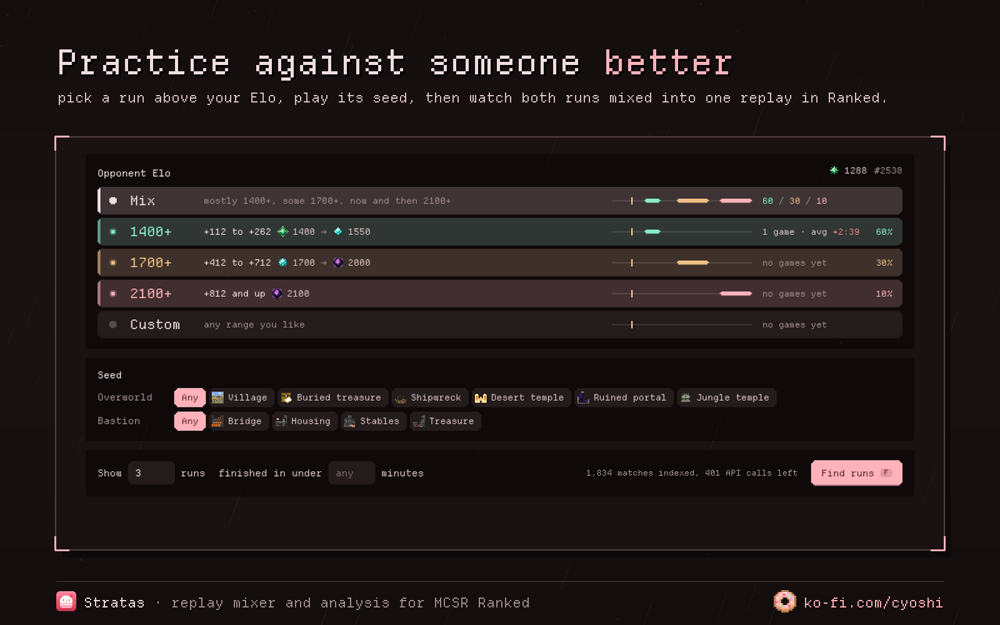
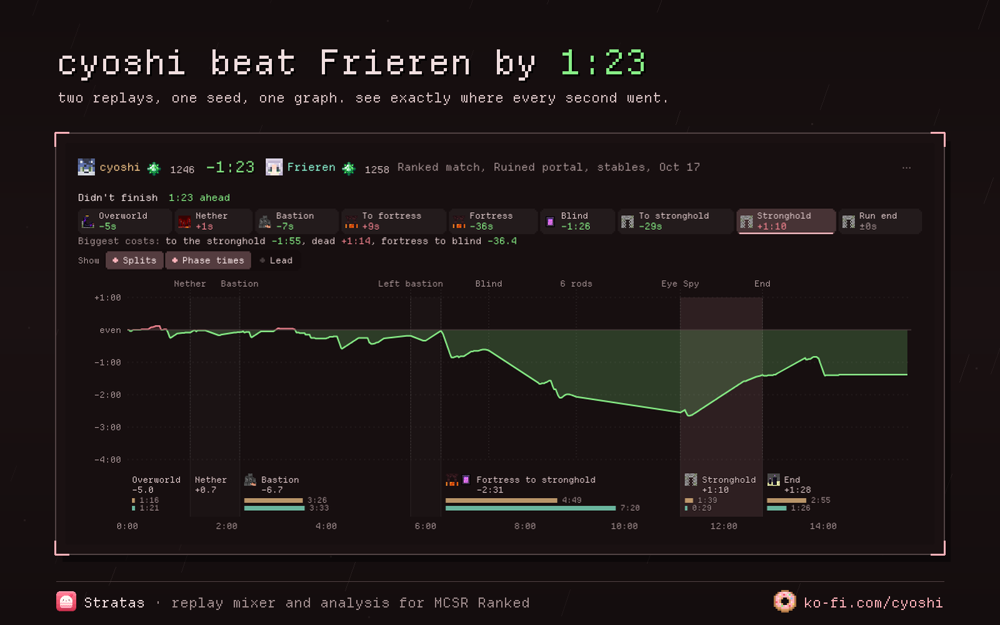
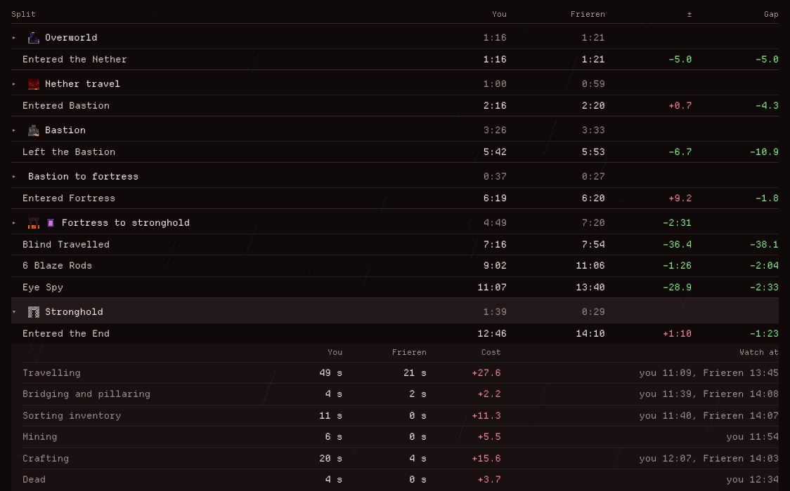
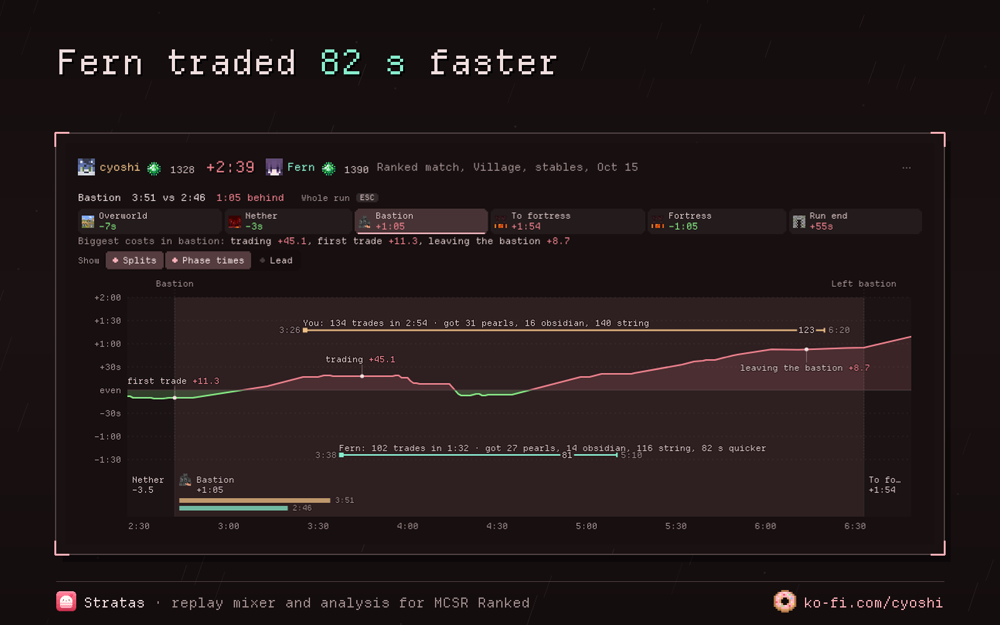
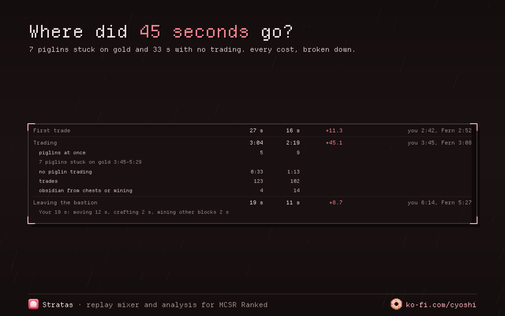
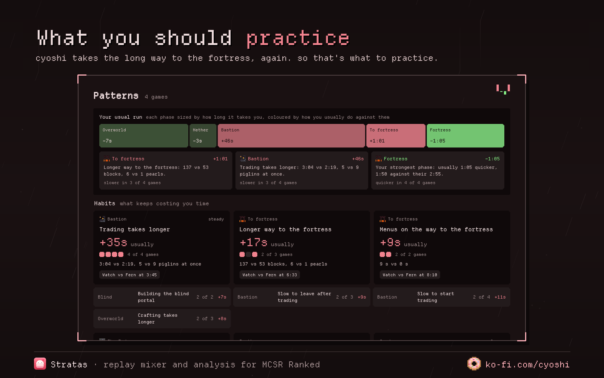
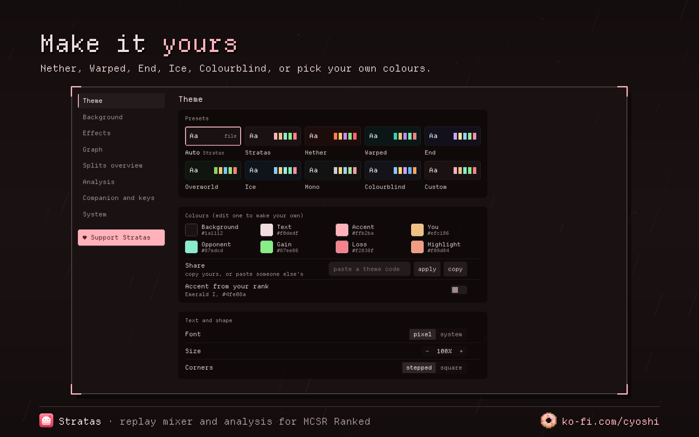
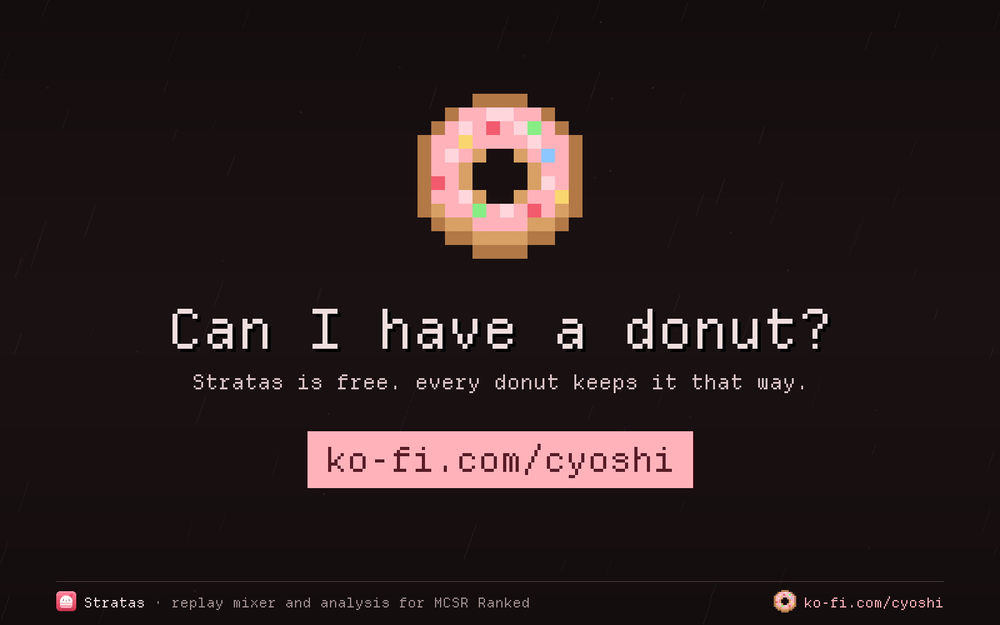

<a href="https://ko-fi.com/cyoshi"></a>

<p align="center"></p>

<p align="center">
  <a href="https://stratas.lol"><b>stratas.lol</b></a> ·
  <a href="#why-stratas"><b>Why</b></a> ·
  <a href="#what-does-it-do"><b>What it does</b></a> ·
  <a href="#why-its-different"><b>Why it's different</b></a> ·
  <a href="#a-look-inside"><b>A look inside</b></a> ·
  <a href="#get-it-running"><b>Get it running</b></a> ·
  <a href="#support-me"><b>Support me</b></a>
</p>

<p align="center">
  
  
  
  
</p>

<br>

## Why Stratas?

Stratas lets you practice against **any Elo you want**, on the **same seed**.

It finds a run from a player at the Elo you pick. You play that seed in a private room. Then Stratas **mixes both replays into one file**, so you open it in Ranked's own replay viewer and you're both in the same world at the same time. No VODs needed, it only uses Ranked's new replays.

<table>
  <tr>
    <td width="50%"></td>
    <td width="50%"></td>
  </tr>
</table>

<br>

## What does it do?

**It analyses the match from every step you do.** Every private room practice, and every ranked game once you download its replay.

<p align="center"></p>

<table>
  <tr>
    <td width="50%" valign="top">
      <p><b>The gap, phase by phase</b><br>where you gained and lost, on a graph you can zoom into</p>
      <p><b>Why you lost time, in plain words</b><br>"7 piglins stuck on gold", "longer way to the fortress", "15 s crafting"</p>
      <p><b>Every trade, craft, pearl and rod</b><br>side by side with theirs, item by item</p>
    </td>
    <td width="50%" valign="top">
      <p><b>Deaths and what they cost</b><br>how long you were gone and what you dropped</p>
      <p><b>The End</b><br>zero cycles, failed cycles, each perch and the dragon kill</p>
      <p><b>What you should practice</b><br>after a few games, the things that keep losing you time</p>
    </td>
  </tr>
</table>

<br>

## Why it's different

- Ranked only lets you watch the people from your own match. Stratas puts **anyone's run on the same seed** into your replay, at whatever Elo you pick, so you can see exactly where you lost or gained time.
- It doesn't just tell you that you lost 40 seconds in the bastion, it tells you **why**, like 7 piglins being stuck on gold.
- After a few games it tells you **what you should practice**, the stuff that keeps losing you time.
- There's no mod and nothing to record. It just uses the replays Ranked already saves.
- Everything stays on your computer. It reads Ranked's files and adds the mixed replays to My replays, that's it.

<br>

## Previews

<table>
  <tr>
    <td width="50%"></td>
    <td width="50%"></td>
  </tr>
  <tr>
    <td width="50%"></td>
    <td width="50%"></td>
  </tr>
</table>

**Configurable settings:** theme presets, your own colours, old Ranked menu backgrounds, rain, snow, embers or stars, and you pick exactly what shows on the graph and in the splits.

<br>

## Get it running

Want to try it first? **[Stratas runs in your browser too](https://stratas.lol/app/)**: your profile and splits, Find runs, and full races from replays you add yourself. The app has all the features and does everything on its own, the browser version is just a taste.

You need MCSR Ranked set up in a launcher. Stratas finds Prism, MultiMC, Modrinth, CurseForge and normal Minecraft Launcher instances on its own. If it doesn't find yours, go to Settings → MCSR Ranked → pick folder.

**Windows**

> [!WARNING]
> The Windows installer isn't signed yet, so Windows will show a blue "Windows protected your PC" popup when you open it. Click **More info** → **Run anyway**. It's safe, it just means Windows doesn't know who made it yet. Signing is applied for through the free [SignPath Foundation](https://signpath.org) and the popup goes away once that's done.

1. Download **[Stratas-Setup.exe](https://github.com/himetau/stratas/releases/latest/download/Stratas-Setup.exe)** and open it.
2. Click past the popup (**More info** → **Run anyway**). It installs and starts by itself.

**Linux**

1. Download **[Stratas.AppImage](https://github.com/himetau/stratas/releases/latest/download/Stratas.AppImage)**.
2. Right click it → Properties → allow it to run as a program (or `chmod +x Stratas.AppImage`), then open it.

Stratas checks for new versions by itself. When there's one, a green update button shows up at the bottom left, click it and it updates and restarts. Older versions and what changed are on the [releases page](https://github.com/himetau/stratas/releases).
<details>
<summary><b>Build it yourself</b></summary>

You need [Git](https://git-scm.com/downloads) and [Node.js](https://nodejs.org) (the LTS one is fine). Then in a terminal:

```
git clone https://github.com/himetau/stratas.git
cd stratas
npm install
npm start
```

`git clone` downloads the code into a `stratas` folder. `npm install` downloads everything Stratas is built with (Electron and a few tools) into `node_modules`, you only need it once. `npm start` builds Stratas and opens it.

`npm run dist` makes the installer for your OS in `release/`. On Linux you can also put `bin/stratas` on your path, it rebuilds when the code changes and `--background` starts it in the tray.

```
npm test
npm run typecheck
npm run snapshot && npm run ui:dev   # the UI in a browser with test data
```

Notes on the replay format are in `docs/replay-format.md`.

</details>

<br>

## Support me

<p align="center"></p>

<p align="center">
Stratas is free and made by one person. If it's helped you find a few seconds,<br>
a donut keeps it going 🍩
</p>

<p align="center"><a href="https://ko-fi.com/cyoshi"></a></p>

<br>

<details>
<summary><b>Code signing policy</b></summary>

The Windows installer is going to be signed for free through SignPath: free code signing provided by [SignPath.io](https://about.signpath.io), certificate by [SignPath Foundation](https://signpath.org). This is applied for and not active yet, so for now the installer isn't signed.

- Author, reviewer and approver: [cyoshi](https://github.com/himetau). Every release is built from this repo by GitHub Actions and approved by hand before it gets signed.
- Downloads: [stratas.lol](https://stratas.lol) and the [releases page](https://github.com/himetau/stratas/releases), both point to the same files built here.
- Privacy: Stratas only talks to the MCSR Ranked API (public match data), Mojang (player skins) and, if you ask it to, Modrinth (old Ranked menu backgrounds). Your replays and settings stay on your computer and are never uploaded.

</details>

<p align="center"><sub>made with 🩷 by cyoshi · <a href="https://stratas.lol">stratas.lol</a> · <a href="LICENSE">GPL-3.0</a> · not affiliated with MCSR Ranked or Mojang</sub></p>
