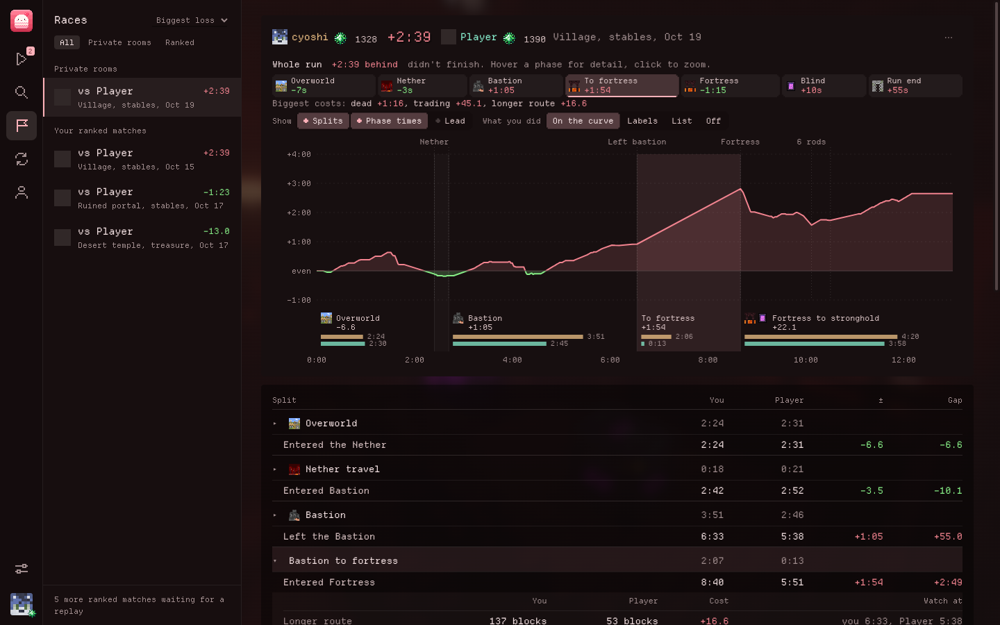
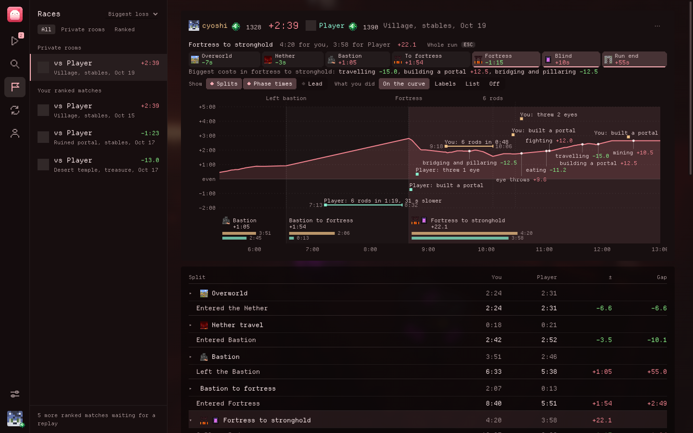
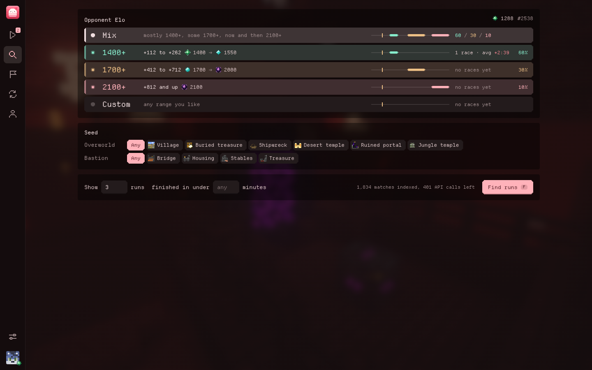
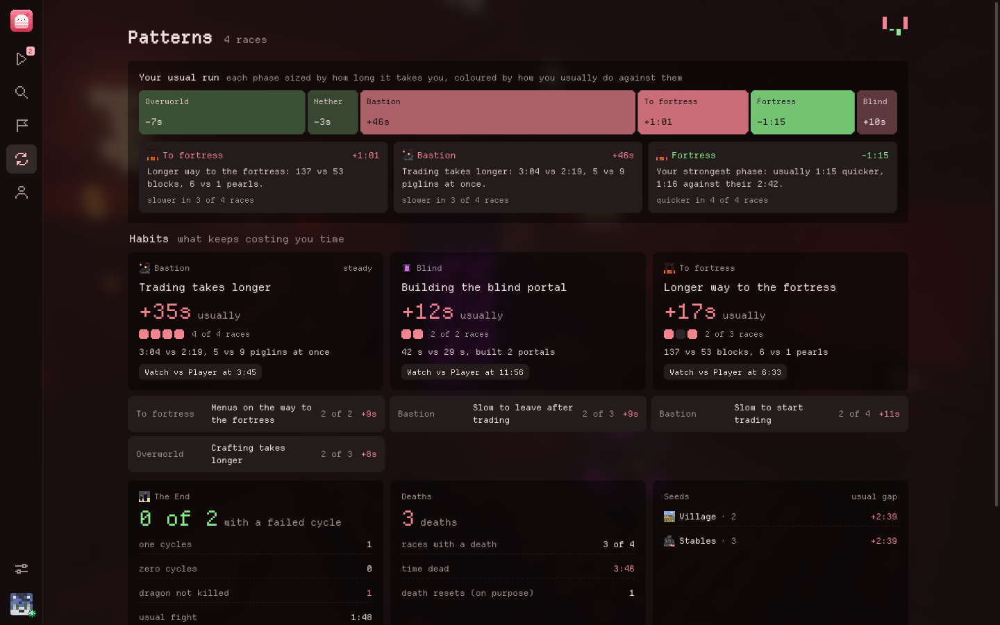

<p align="center"></p>

<h1 align="center">Stratas</h1>

<p align="center">Play a private room seed, then watch your run side by side with a player at any Elo you pick.</p>



## What it does
Stratas finds a ranked run from a player at the Elo you choose. You play that same seed in a private room, and Stratas mixes your replay and theirs into one file. You open it in Ranked's own replay viewer and both of you are in the same world at the same time.

## Why you'd want this
- In ranked you only ever see people around your own Elo. This lets you play against how a 1700 or a 2000 plays the exact same seed.
- You pick the level. Go a little above you to see what's realistic next, or way above to see how it's really done.
- Watching them in the same world shows you things a VOD won't, like where they cut the route, how fast they leave the bastion and when they start throwing eyes.
- It's practice without the pressure. No Elo on the line, and you can do it as many times as you want.

## What you get after each run
- The gap phase by phase: to fortress, fortress, blind, to stronghold, stronghold and the End
- Why you lost time in each phase, in plain words, like a longer route, slow trading, an extra portal or a death
- The End too: zero cycles, failed cycles, the dragon kill and Free the End



## Picking the Elo
Choose a level above you, mix them, or set your own range. It keeps track of how your runs at each level went.



## Patterns
After a few runs it shows your usual run and the habits that keep costing you time.



## Running it
Linux only for now. You need Node and an MCSR Ranked instance (Prism, MultiMC and Modrinth are found automatically).
```
npm install
npm start
```
You can also put `bin/stratas` on your path. It rebuilds when the code changes, and `--background` starts it in the tray.

Stratas only reads Ranked's files and adds replays to My replays. Nothing gets uploaded.

## Development
```
npm test
npm run typecheck
npm run snapshot && npm run ui:dev   # the UI in a browser with test data
```
Notes on the replay format are in `docs/replay-format.md`.
